<p align="center">
  
</p>

<h1 align="center">Vitafarma</h1>

<p align="center">
  Sistem kasir dan stok apotek berbasis web untuk mengelola obat per batch, resep dokter, dan transaksi harian.
</p>

<p align="center">
  React 18 · Tailwind CSS 3 · Laravel 11 · MySQL 8 · Laravel Sanctum
</p>

<p align="center">
  Status: MVP selesai dan siap dikembangkan
</p>

---

## Tentang Proyek

Vitafarma adalah aplikasi POS (Point of Sale) apotek yang dipakai oleh staf internal apotek. Aplikasi ini membantu apotek menjaga urutan penjualan obat berdasarkan tanggal kedaluwarsa, mencegah obat expired terjual, mencatat stok per batch, dan mencatat penebusan resep dokter.

Masalah yang diselesaikan:

- Obat yang mendekati expired sulit dipantau dan berisiko menjadi kerugian.
- Stok obat tidak tercatat per batch, sehingga sisa stok dan tanggal expired tidak jelas.
- Stok minimum tidak diketahui sampai obat benar-benar habis.
- Resep dokter, termasuk racikan, masih dicatat manual dan sulit ditelusuri.
- Pembagian batch saat penjualan sering dilakukan manual dan tidak konsisten.

Fokus versi MVP:

- Stok multi-batch dengan metode **FEFO** (First Expired, First Out).
- Blokir otomatis batch expired dari penjualan dan penebusan resep.
- Peringatan stok minimum pada dashboard.
- Pencatatan resep jadi dan resep racikan.
- Penebusan resep menjadi tepat satu transaksi.
- Hak akses Admin, Apoteker, dan Kasir.
- Riwayat transaksi yang tidak dapat diubah atau dihapus.

## Fitur Utama

**Autentikasi dan hak akses**

- Login staf dengan email dan kata sandi.
- Token API memakai Laravel Sanctum dan disimpan di `localStorage`.
- Middleware peran pada setiap endpoint.
- Akun nonaktif tidak dapat masuk dan token aktifnya ditolak.

**Dashboard**

- Total penjualan dan jumlah transaksi hari ini.
- Daftar obat yang stok siap jualnya menyentuh atau berada di bawah stok minimum.
- Peringatan diurutkan dari selisih stok terkecil.

**Kasir Penjualan**

- Pencarian obat dengan debounce 300 ms.
- Hanya obat jadi yang dapat dijual.
- Keranjang dengan ubah jumlah dan validasi stok siap jual.
- Pratinjau pembagian batch FEFO per baris.
- Perhitungan total, uang diterima, dan kembalian.
- Nomor transaksi otomatis dengan format `TRX-YYYYMMDD-0001`.

**Stok dan batch**

- Stok total, stok siap jual, dan stok expired per obat.
- Batch expired tetap tercatat, tetapi ditandai tidak dapat dijual.
- Penerimaan batch baru dengan nomor batch unik per obat.
- Tanggal expired wajib lebih besar dari hari ini.
- Kode obat otomatis dengan format `OBT-00001`.

**Resep dokter**

- Resep jadi dan resep racikan.
- Data pasien, nomor rekam medis, dokter, dan nomor SIP.
- Satu obat tidak boleh muncul dua kali dalam satu resep.
- Kode resep otomatis dengan format `RSP-YYYYMMDD-0001`.
- Resep berstatus `menunggu` atau `ditebus`.
- Penebusan memakai FEFO dan menghasilkan satu transaksi per resep.
- Jika stok salah satu baris tidak cukup, seluruh penebusan dibatalkan dan stok tidak berubah.

**Transaksi**

- Daftar transaksi penjualan dan penebusan resep.
- Pagination server-side 20 baris.
- Detail transaksi memuat item, batch, tanggal expired, total, uang diterima, kembalian, kasir, dan data resep.
- Transaksi tidak memiliki endpoint ubah atau hapus agar jejak stok tetap utuh.

**Pengguna**

- Admin dapat menambah akun staf, mengubah peran, dan menonaktifkan akun.
- Email wajib unik dan kata sandi minimal 8 karakter.
- Peran divalidasi hanya `admin`, `apoteker`, atau `kasir`.

## Peran dan Hak Akses

| Halaman | Admin | Apoteker | Kasir |
| :--- | :---: | :---: | :---: |
| Masuk | Ya | Ya | Ya |
| Dashboard | Ya | Ya | Ya |
| Kasir Penjualan | Ya | Tidak | Ya |
| Lihat Stok | Ya | Ya | Ya |
| Daftar dan Detail Obat | Ya | Ya | Tidak |
| Daftar Resep | Ya | Ya | Tidak |
| Catat Resep Baru | Ya | Ya | Tidak |
| Detail Resep dan Penebusan | Ya | Ya | Tidak |
| Daftar dan Detail Transaksi | Ya | Ya | Ya |
| Kelola Pengguna | Ya | Tidak | Tidak |

## Halaman Aplikasi

Seluruh screenshot di bawah menggunakan data seed yang disediakan proyek.

| Halaman | Rute | Peran |
| :--- | :--- | :--- |
| Masuk | `/login` | Publik untuk staf |
| Dashboard | `/dashboard` | Admin, Apoteker, Kasir |
| Kasir Penjualan | `/kasir` | Admin, Kasir |
| Lihat Stok | `/stok` | Admin, Apoteker, Kasir |
| Daftar Obat | `/obat` | Admin, Apoteker |
| Detail Obat dan Batch | `/obat/:id` | Admin, Apoteker |
| Daftar Resep | `/resep` | Admin, Apoteker |
| Catat Resep Baru | `/resep/baru` | Admin, Apoteker |
| Detail Resep dan Penebusan | `/resep/:id` | Admin, Apoteker |
| Daftar Transaksi | `/transaksi` | Admin, Apoteker, Kasir |
| Detail Transaksi | `/transaksi/:id` | Admin, Apoteker, Kasir |
| Kelola Pengguna | `/pengguna` | Admin |

### Masuk

Formulir email dan kata sandi untuk seluruh staf. Validasi dilakukan di sisi klien dan server. Halaman ini tidak menampilkan daftar akun demo.

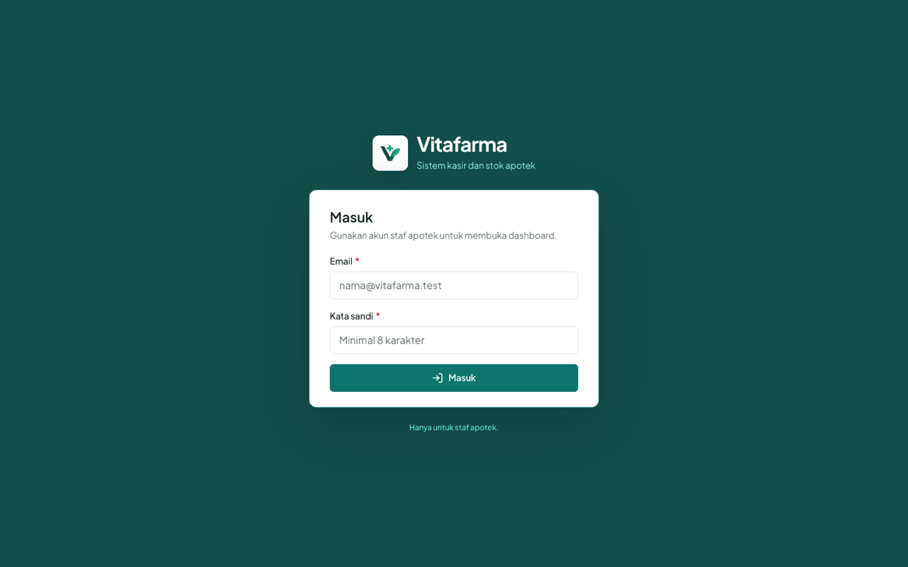

### Dashboard

Ringkasan operasional hari ini dan peringatan stok minimum. Total penjualan dan jumlah transaksi dihitung dari transaksi dengan tanggal hari ini sesuai zona waktu server.

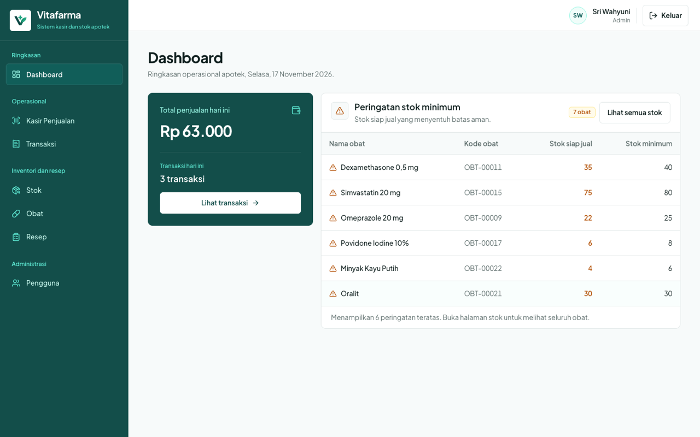

### Kasir Penjualan

Pencarian obat, keranjang, pratinjau batch FEFO, uang diterima, dan kembalian. Pengguna dapat menekan baris obat untuk menambahkan ke keranjang, lalu mengubah jumlah sebelum menyimpan transaksi.

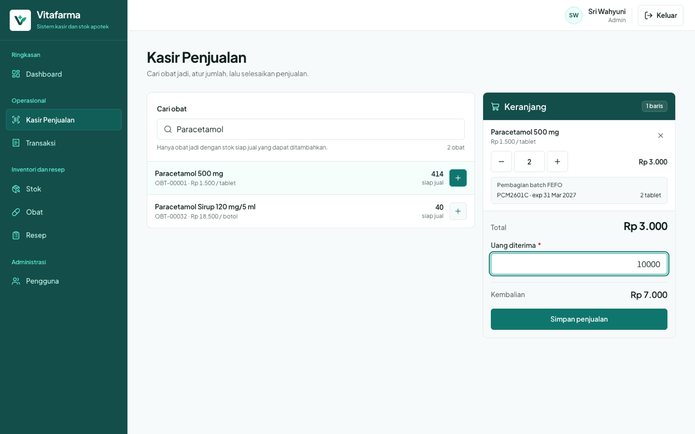

### Lihat Stok

Tiga angka utama untuk setiap obat: stok total, stok siap jual, dan stok expired. Bagian bawah menampilkan batch yang sudah expired beserta keterangan bahwa batch tersebut tidak dapat dijual.

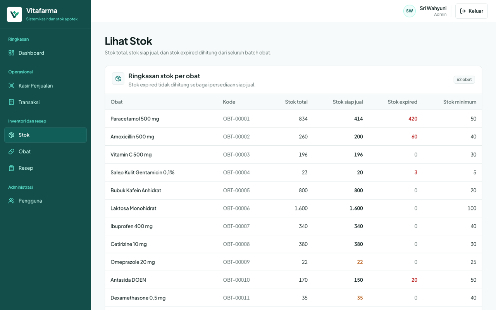

### Daftar Obat

Daftar obat dengan pagination server-side 20 baris. Data mencakup kode, nama, jenis, satuan, harga jual, dan stok minimum.

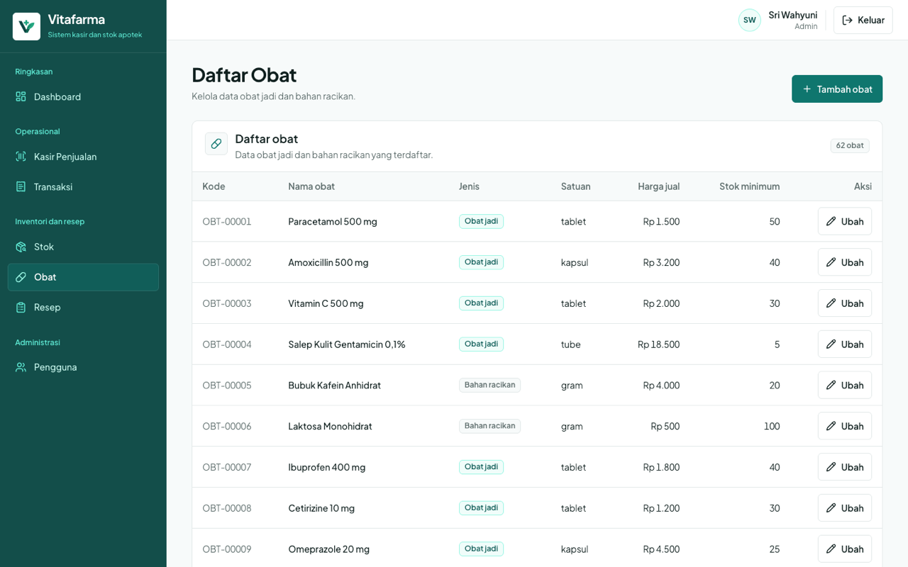

### Detail Obat dan Batch

Detail satu obat, daftar batch yang diurutkan dari tanggal expired terdekat, serta formulir penerimaan batch baru. Nomor batch wajib unik untuk obat tersebut.

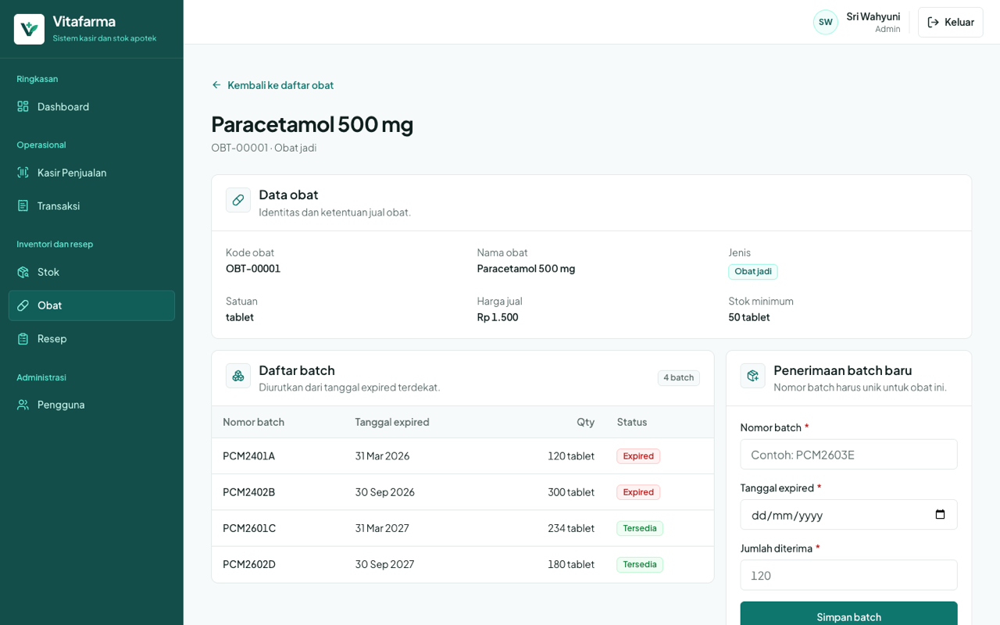

### Daftar Resep

Daftar resep dokter dengan kode resep, tanggal, nama pasien, nama dokter, jenis resep, dan status penebusan.

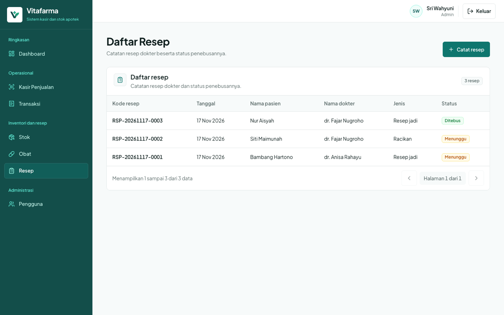

### Detail Resep dan Penebusan

Detail pasien, dokter, daftar obat atau bahan, pratinjau FEFO, total resep, uang diterima, dan tombol penebusan. Resep yang sudah ditebus tidak dapat ditebus ulang.

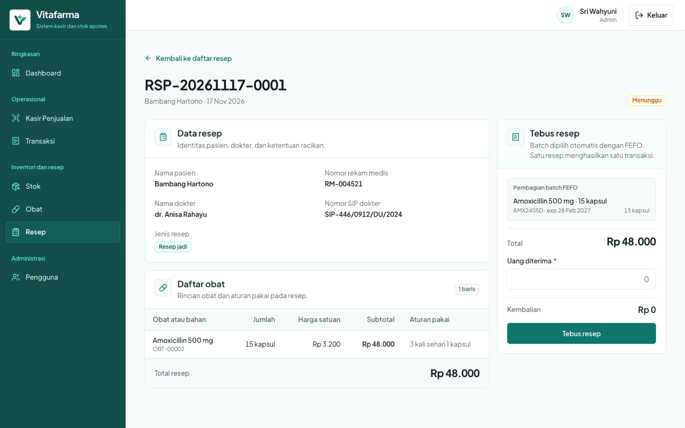

### Catat Resep Baru

Formulir data pasien, data dokter, jenis resep, baris obat atau bahan, nama racikan, dan aturan pakai. Satu obat tidak dapat muncul dua kali dalam satu resep.

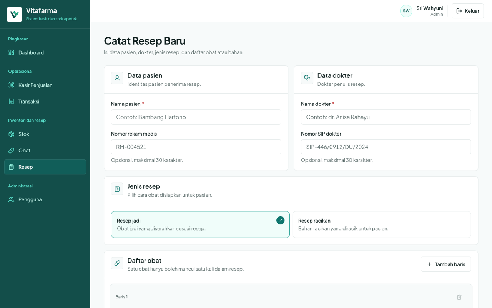

### Daftar Transaksi

Transaksi penjualan dan penebusan resep diurutkan dari yang terbaru, dengan pagination 20 baris.

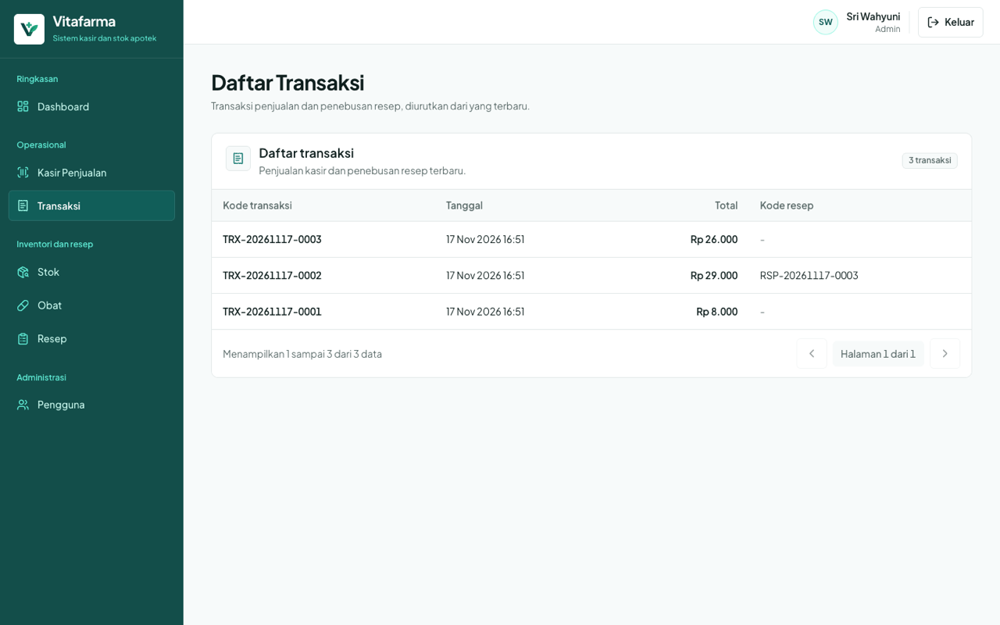

### Detail Transaksi

Detail item, batch, tanggal expired, total, uang diterima, kembalian, kasir, dan data resep bila transaksi berasal dari penebusan resep.

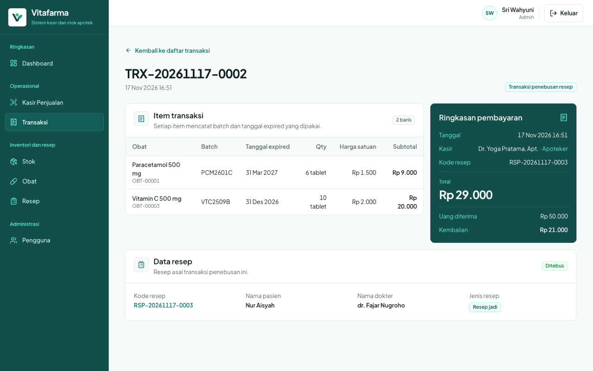

### Kelola Pengguna

Admin dapat melihat seluruh akun staf, menambah akun, mengubah peran, dan menonaktifkan akun.

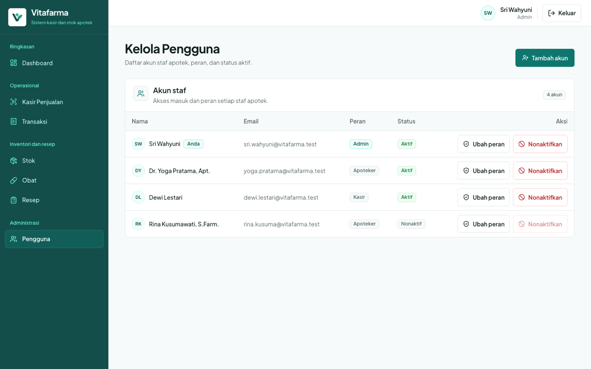

### Tampilan Responsif

Sidebar berubah menjadi drawer pada layar kecil. Tabel padat tetap dapat digeser secara horizontal dengan petunjuk yang muncul saat dibutuhkan.

<p>
  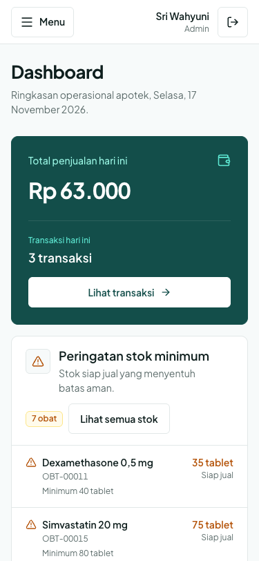
  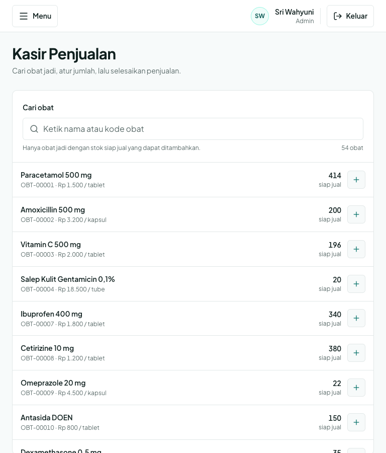
</p>

## Aturan Bisnis Penting

### FEFO

- Hanya batch berstatus `tersedia` yang dapat dipakai.
- Urutan batch: tanggal expired paling awal, lalu `id` batch paling kecil.
- Jika satu baris membutuhkan lebih dari satu batch, sistem membuat rincian per batch.
- Batch expired tidak pernah dipilih, tetapi tetap dihitung sebagai stok expired.

### Status batch

- `tersedia`: qty lebih dari 0 dan tanggal expired hari ini atau setelahnya.
- `habis`: qty 0.
- `expired`: tanggal expired sudah lewat.
- Status dihitung ulang setiap kali data dibaca.

### Stok

- Stok total = jumlah qty seluruh batch.
- Stok siap jual = jumlah qty batch berstatus tersedia.
- Stok expired = jumlah qty batch berstatus expired.
- Stok minimum hanya memunculkan peringatan jika nilainya lebih besar dari 0.
- Peringatan dashboard membandingkan stok siap jual dengan stok minimum, bukan stok total.

### Transaksi dan penguncian stok

- Pengurangan stok dilakukan di dalam transaksi database.
- Baris batch dikunci dengan `SELECT ... FOR UPDATE` agar dua kasir tidak menjual batch yang sama secara bersamaan.
- Jika stok siap jual tidak cukup, seluruh transaksi ditolak dan stok tidak berubah.
- Satu resep menghasilkan tepat satu transaksi dengan `resep_id` terisi.

### Format kode

- Obat: `OBT-00001`
- Resep: `RSP-YYYYMMDD-0001`
- Transaksi: `TRX-YYYYMMDD-0001`

## Arsitektur

```text
React 18 + Vite + Tailwind CSS
            |
            | REST API, Bearer token Sanctum
            v
Laravel 11 /api/v1
Controllers -> Services -> Eloquent
            |
            v
      MySQL 8.0
```

Frontend memakai React Router untuk routing, TanStack Query untuk data server, dan Lucide React untuk ikon. Backend memakai controller tipis, service untuk stok dan FEFO, serta middleware peran.

Struktur folder utama:

```text
vitafarma/
├── backend/
│   ├── app/Http/Controllers/Api/
│   ├── app/Http/Middleware/
│   ├── app/Models/
│   ├── app/Services/
│   ├── app/Support/
│   ├── database/migrations/
│   ├── database/seeders/
│   └── routes/api.php
├── frontend/
│   ├── public/
│   ├── src/components/
│   ├── src/context/
│   ├── src/hooks/
│   ├── src/images/
│   ├── src/lib/
│   └── src/pages/
├── docs/screenshots/
└── README.md
```

## Endpoint API

Base URL: `/api/v1`

| Method | Endpoint | Akses |
| :--- | :--- | :--- |
| POST | `/login` | Publik |
| POST | `/logout` | Semua peran yang sudah masuk |
| GET | `/me` | Semua peran yang sudah masuk |
| GET | `/dashboard` | Semua peran |
| GET | `/stok` | Semua peran |
| GET | `/obat` | Admin, Apoteker |
| POST | `/obat` | Admin, Apoteker |
| GET | `/obat/{id}` | Admin, Apoteker |
| PUT | `/obat/{id}` | Admin, Apoteker |
| GET | `/obat/{id}/batch` | Admin, Apoteker |
| POST | `/obat/{id}/batch` | Admin, Apoteker |
| GET | `/resep` | Admin, Apoteker |
| POST | `/resep` | Admin, Apoteker |
| GET | `/resep/{id}` | Admin, Apoteker |
| POST | `/resep/{id}/tebus` | Admin, Apoteker |
| GET | `/transaksi` | Semua peran |
| GET | `/transaksi/{id}` | Semua peran |
| POST | `/transaksi/penjualan` | Admin, Kasir |
| GET | `/pengguna` | Admin |
| POST | `/pengguna` | Admin |
| PUT | `/pengguna/{id}` | Admin |
| PATCH | `/pengguna/{id}/nonaktif` | Admin |

Semua endpoint selain login memerlukan header:

```http
Authorization: Bearer <token>
Accept: application/json
```

## Struktur Database

| Tabel | Fungsi |
| :--- | :--- |
| `users` | Akun staf, peran, dan status aktif |
| `obat` | Master obat jadi dan bahan racikan |
| `batch` | Batch obat, tanggal expired, dan qty |
| `resep` | Data pasien, dokter, jenis resep, dan status |
| `resep_item` | Baris obat atau bahan dalam resep |
| `transaksi` | Transaksi penjualan dan penebusan resep |
| `transaksi_item` | Rincian item, batch, qty, dan subtotal |

Skema mengikuti DDL pada dokumen PRD. Relasi utama memakai foreign key, unique key, dan index untuk pencarian serta pengurutan.

## Data Seed

Seeder menyediakan data pengembangan yang cukup untuk mencoba seluruh alur:

- 4 akun staf, termasuk 1 akun nonaktif.
- 62 obat dengan kategori analgesik, antibiotik, saluran cerna, kardiometabolik, vitamin, salep, antiseptik, alat kesehatan, dan bahan racikan.
- 76 batch, termasuk contoh batch expired.
- 3 resep, satu di antaranya sudah ditebus.
- 3 transaksi hari ini untuk mengisi dashboard.

Akun seed untuk pengembangan lokal:

| Peran | Email | Kata sandi |
| :--- | :--- | :--- |
| Admin | `sri.wahyuni@vitafarma.test` | `vitafarma123` |
| Apoteker | `yoga.pratama@vitafarma.test` | `vitafarma123` |
| Kasir | `dewi.lestari@vitafarma.test` | `vitafarma123` |
| Apoteker nonaktif | `rina.kusuma@vitafarma.test` | `vitafarma123` |

> Akun seed hanya untuk pengembangan lokal. Ganti seluruh kredensial sebelum aplikasi dipakai di lingkungan produksi. Akun nonaktif disediakan untuk menguji penolakan login.

## Menjalankan Secara Lokal

### Prasyarat

- PHP 8.2 atau lebih baru.
- Composer 2.
- Node.js 20 atau lebih baru.
- MySQL 8.0.

### 1. Siapkan database

```sql
CREATE DATABASE vitafarma CHARACTER SET utf8mb4 COLLATE utf8mb4_unicode_ci;
CREATE USER 'vitafarma_user'@'localhost' IDENTIFIED BY '';
GRANT ALL PRIVILEGES ON vitafarma.* TO 'vitafarma_user'@'localhost';
FLUSH PRIVILEGES;
```

### 2. Jalankan backend

```bash
cd backend
composer install
cp .env.example .env
php artisan key:generate
```

Sesuaikan `DB_HOST`, `DB_PORT`, `DB_DATABASE`, `DB_USERNAME`, dan `DB_PASSWORD` di `backend/.env`. Pastikan `CORS_ALLOWED_ORIGINS` berisi alamat frontend, misalnya:

```env
CORS_ALLOWED_ORIGINS=http://localhost:5173
```

Jika Composer menolak instalasi karena kebijakan advisory Laravel 11, gunakan:

```bash
composer install --no-blocking
```

Lanjutkan dengan migration, seeder, dan server:

```bash
php artisan migrate --seed --force
php artisan serve --host=127.0.0.1 --port=8000
```

API berjalan di `http://localhost:8000/api/v1`.

### 3. Jalankan frontend

```bash
cd frontend
npm ci
cp .env.example .env
```

Isi `frontend/.env`:

```env
VITE_API_BASE_URL=http://localhost:8000/api/v1
VITE_APP_NAME=Vitafarma
```

Jalankan:

```bash
npm run dev -- --host localhost --port 5173
```

Buka `http://localhost:5173`.

Gunakan `localhost`, bukan `127.0.0.1:5173`, agar origin sesuai dengan konfigurasi CORS backend.

## Build Produksi

Frontend:

```bash
cd frontend
npm run build
```

Isi folder `frontend/dist` siap diunggah ke hosting statis. Aktifkan SPA fallback ke `index.html` agar refresh pada rute seperti `/dashboard` atau `/obat/1` tidak menghasilkan 404. Saat build, atur `VITE_API_BASE_URL` ke URL API produksi.

Backend:

```bash
cd backend
composer install --no-dev --optimize-autoloader
php artisan migrate --force
php artisan config:cache
php artisan route:cache
php artisan view:cache
```

Jika Composer memblokir instalasi karena kebijakan advisory Laravel 11, tambahkan `--no-blocking` pada perintah `composer install`.

Arahkan document root ke `backend/public`, aktifkan HTTPS, dan sesuaikan `APP_URL`, kredensial database, serta `CORS_ALLOWED_ORIGINS` dengan domain frontend produksi.

## Pengujian

```bash
cd backend
php artisan test
```

Tes backend mencakup autentikasi, hak akses, FEFO, blokir batch expired, kalkulasi stok, stok minimum, resep jadi, racikan, penebusan, pembatalan karena stok kurang, pagination, dan CORS.

Saat dokumentasi ini dibuat, suite backend berisi 13 tes dengan 114 assertion.

```bash
cd frontend
npm run build
npm run lint
```

## Catatan dan Batasan

- Cetak struk dan pembayaran daring belum termasuk dalam cakupan MVP.
- Foto produk belum disertakan. Skema database saat ini belum memiliki kolom gambar, dan katalog memakai nama generik dengan harga realistis. Jika foto dibutuhkan, tambahkan kolom media pada iterasi berikutnya.
- Laravel 11 dipilih sesuai kebutuhan proyek. Jalankan `composer audit` sebelum produksi dan tinjau pembaruan keamanan framework.
- Data seed dan akun pengembangan tidak boleh dipakai langsung di produksi.
- Logo Vitafarma disediakan oleh pemilik proyek dan disimpan di `frontend/src/images/logo-vitafarma.jpg`. Aset turunannya adalah `logo-mark.png`, `favicon.png`, dan `apple-touch-icon.png`.

---

<p align="center">
  Vitafarma · Sistem kasir dan stok apotek
</p>
